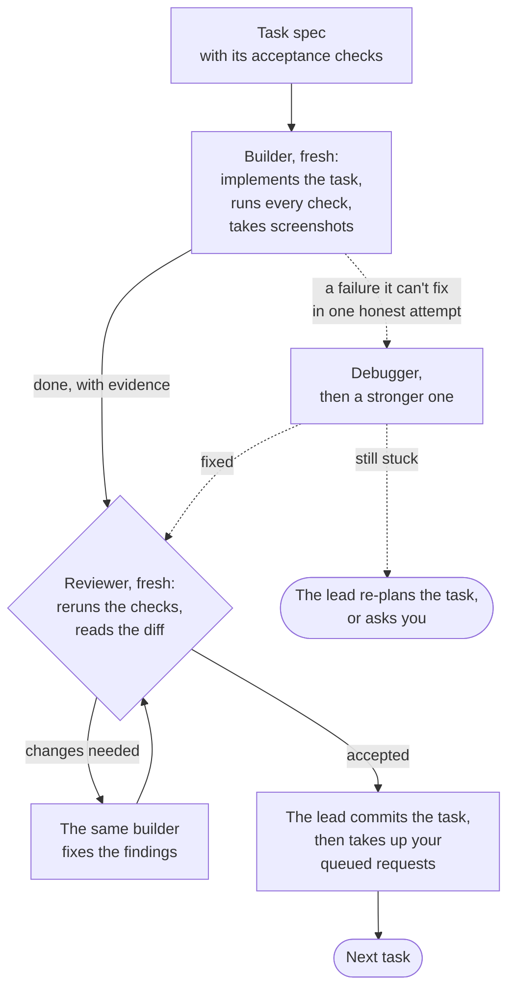
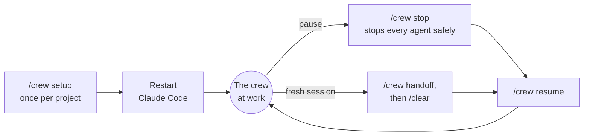

# Crew

**A software team inside Claude Code.** Crew makes your Claude Code session the lead of a small crew of specialist agents. You bring the idea. The lead plans it with you, then the crew builds it one task at a time: each task is built, reviewed independently, tested and committed. It keeps going for hours while you're away, and a live dashboard on your desktop or your phone shows what it's doing.

[Why Crew](#why-crew) · [Getting started](#getting-started) · [How it works](#how-it-works) · [The dashboard](#the-dashboard) · [Commands](#commands) · [Configuration](#configuration)

## Why Crew

- **It keeps working while you're away.** The lead makes every decision that isn't yours to make. For the ones that are, it takes a sensible default, writes it down, and saves the question for one batch at the next milestone. Nothing waits on you, and on a Mac the computer stays awake while the crew works.
- **Every task is checked before it's committed.** Each task's acceptance checks are written before any code. A fresh reviewer, who never saw the builder's reasoning, reruns every check and reads the diff. Reports need evidence, such as test output and screenshots.
- **The right model for every job.** Opus where judgement matters: leading, planning, reviewing. Sonnet builds at half Opus's price. Haiku reads, searches and makes bulk edits for a fraction of that. Fable gives a second, independent opinion before decisions that are costly to reverse.
- **You stay in charge without watching over it.** Talk to the lead at any time. It acknowledges each request in three lines, queues it, and applies it between tasks, never in the middle of one. It interrupts you only for what it must not decide alone: a production deploy, a force-push, a destructive data change, spending over budget, a security risk.
- **You see everything as it happens.** Progress, running agents, a timeline of every agent run, the critical path, open defects, what each context compaction cost, and the full journal. On your phone too: scan a QR code.
- **A clean git history.** One branch per set of tasks and one commit per accepted task. Independent tasks are built in parallel, each in its own git worktree, then merged locally. Nothing is pushed without your approval.
- **Built for long sessions.** State lives in files and the rules survive context compaction, so the lead keeps working through it. When you want a fresh session, `/crew handoff` and `/crew resume` pick up exactly where it stopped.
- **Works with your planning method.** Crew comes with its own (small tasks, each with checks that prove it's done), and you can use any other.

## Getting started

**1. Check the requirements.**

| Requirement | Why |
| --- | --- |
| Claude Code v2.1.292 or later | Lets the lead raise an agent's effort for harder work. Older versions work, without that. |
| git | Branches, commits and parallel builds. Without it, the crew still works, with none of those. |
| jq | The crew's hooks need it. `/crew setup` installs it if it's missing. |
| Node.js 20 or later | Only for the dashboard. Everything else works without it. |

**2. Install the skill.**

```sh
aitools install @gh/claudio-silva/ai-toolbox crew
# or
npx skills add claudio-silva/ai-toolbox --skill crew -a claude-code
```

**3. Set up your project.** In Claude Code, at the root of your project, run:

```
/crew setup
```

Setup lists every change it's about to make, then adds the crew's agents, hooks and files to the project ([what it adds](#what-setup-adds-to-your-project)). It asks only what it can't learn from the repository. Then **restart Claude Code** so the hooks and agents load. Run setup again after each skill update.

**4. Pick the lead's model.** Run the main session on **Opus 5.5 at High effort** (`/model`). The lead's work is judgement: plans, routing, reviews, decisions. It hands the bulk work to cheaper models.

**5. Tell the lead what you want.** Plain words are enough:

> I want readers to export a book to EPUB. Let's plan it.

> Here's the PRD for v2: …

> What's next?

The lead works out the goal and the scope with you, asks its questions up front, and gets the crew going once you confirm the plan.

**6. Open the dashboard.** The lead's first reply starts with *Open the dashboard at http://…* (or run `.crew/bin/crew status`). Keep it in a browser tab or a Paseo side panel. To follow along on your phone, click the QR code button in its header and scan it.

**7. Walk away.** When you come back, you'll find a milestone report and a short batch of questions. Say "continue", or change course.

## How it works

### From idea to milestone


The yellow steps are yours. Before decisions that are costly to reverse, such as the roadmap, a milestone plan or the architecture, the lead asks the advisor for a second opinion.

### The life of a task



- **Small issues don't block a task.** A minor finding that no other work depends on is logged as a defect and fixed before the set closes, so it doesn't cost another review round. One that gets in the way of other work is fixed at once.
- **Independent tasks can run in parallel,** each builder in its own git worktree.
- **Every step appears on the dashboard as it happens.**

### Meet the crew

| Role | Model · effort | What it does |
| --- | --- | --- |
| **Lead** | Opus · high | Your main session. Plans with you, assigns the work, checks the results, makes the decisions, talks to you. |
| **Planner** | Opus · high | Splits a plan into tasks with acceptance checks, after reading the real code. |
| **Builder** | Sonnet · medium (high for judgement calls) | Implements a task and the tests that matter for it. |
| **Reviewer** | Opus · medium | Checks every task independently, and never reviews its own work. |
| **Debugger** | Sonnet · high, escalating to Opus · xhigh | Takes over a failure that survived one fix attempt. |
| **QA** | Sonnet · medium (Haiku for scripted runs) | Drives the real UI: key user journeys, exploratory sessions, screenshots. |
| **Scout** | Haiku · medium | Reads, searches and summarises, so the lead's own context stays small. |
| **Worker** | Haiku · high | Mechanical bulk changes: renames, moves, sweeps. |
| **Advisor** | Fable · high | A second opinion on the vision, the roadmap and costly-to-reverse decisions. |

### Talking to the crew while it works

| You say… | The lead… |
| --- | --- |
| A question, such as "why did you choose X?" | Answers right away. |
| "Stop", "do X first" | Does it now. |
| Anything that changes what gets built, such as "make the button blue" or "also add export" | Replies in three lines: what it understood, what it affects and costs, and when it will happen. Then it queues the request and applies it once the current task is accepted. |

If a request makes running work pointless, the lead stops those agents at once. Before undoing work already accepted, it asks you.

| When the lead is unsure about… | It… |
| --- | --- |
| Something irreversible (a deploy, a force-push, destroying data), a security risk, spending over budget, a missing credential, or no work left | Asks you right away. |
| Something that's yours to decide, but not blocking | Takes a sensible default, writes it down, and asks you in the next batch. |
| Anything else | Decides, and records why. |

### Sessions



The lead never runs out of room. When its context fills up, Claude Code compacts it and the crew's rules come back with it, so it simply carries on. A fresh session is your call, not a necessity.

## The dashboard

A live page for following the crew, in a browser tab, a Paseo side panel or on your phone. It updates the moment something changes, with no reload, and running clocks tick in real time. It follows your system's light or dark theme, or the one you pick, and its header shows your project's icon when it has one.

| Tab | What it shows |
| --- | --- |
| **Overview** | The current set's progress, the task in hand, the lead's state, running agents, questions waiting for you, requests, defects, the crew's time at work, and recent activity |
| **Tasks** | The dependency graph with the critical path highlighted; each task opens its spec, its agent runs and its screenshots |
| **Timing** | Where the time went (agents, the lead alone, idle, asleep), a zoomable timeline of every agent run, build, review and rework per task, and time by role |
| **Requests** | Your open questions first, then your requests: queued, scheduled, done and dropped |
| **Defects** | Minor issues logged for later, when each is due, and a legend for every label |
| **Compactions** | Every context compaction: size before and after, and its estimated cost and savings |
| **Journal** | Everything the crew did, newest first, searchable |
| **Sets** | Every set of tasks, including those in other worktrees |

**On your phone or tablet.** The address the lead gives you works from any device on the same Wi-Fi or Tailscale network, and the QR code button shows it as a code to scan. The address includes a private key for the project, so other people on the network can't read it. If the crew runs on a remote server, open the dashboard through an SSH tunnel, `ssh -N -L <port>:127.0.0.1:<port> <server>`, then `http://127.0.0.1:<port>/`, with no key.

## Commands

| Command | What it does |
| --- | --- |
| `/crew setup` | Prepares the project. Run it once, and again after each skill update. |
| `/crew stop` | Stops every running agent safely and records where things stand. |
| `/crew resume` | Continues after a stop, or in a fresh session after a handoff. |
| `/crew handoff` | Waits for running work and writes a handoff note. Then `/clear` and `/crew resume`. |
| `.crew/bin/crew status` | Prints the dashboard's address, starting the dashboard if needed. |

## Configuration

- **`docs/CREW.md`** holds your project's own rules: facts about the project and anything that differs from the crew's defaults. It overrides the skill. Setup writes it with you.
- **The question timeout.** Setup offers to give the lead's questions 10 minutes. If you don't answer in time, the lead takes its default and moves on.
- **Compaction windows** are yours to tune. The Compactions tab shows what each compaction cost and saved.
- **Environment variables:**
  - `CREW_DASHBOARD=0`: don't start the dashboard.
  - `CREW_DASHBOARD_LAN=0`: keep the dashboard on this computer only.
  - `CREW_KEEP_AWAKE=0`: let the computer sleep.

### What setup adds to your project

| | What | Where |
| --- | --- | --- |
| **Committed** (shared with your team) | Your project's crew rules | `docs/CREW.md` |
| | A short pointer block | `CLAUDE.md` |
| | The crew's agents | `.claude/agents/` |
| | Hooks and a permission rule, merged into your settings | `.claude/settings.json` |
| | Plans, sets of tasks, the request queue, the defect log, the handoff note, the crew script and its templates | `.crew/` |
| **Not committed** | The journal, the dashboard, screenshots and logs per task, scratch state | `.crew/` (gitignored) |

## Learn more

- How the lead plans and runs work: [planning](reference/planning.md), [execution](reference/execution.md), [testing and QC](reference/testing.md)
- How it deals with you: [questions and milestones](reference/founder.md), [requests while work runs](reference/requests.md)
- [The roles](reference/roles.md), with the model facts behind each choice, and [context and cost](reference/context.md)
- Working on the skill itself: [DEVELOPING.md](DEVELOPING.md)

Crew is for Claude Code only: it relies on Claude Code's subagents and its per-agent model and effort settings. See the [repository README](../../../README.md) for the other tools in this collection.
