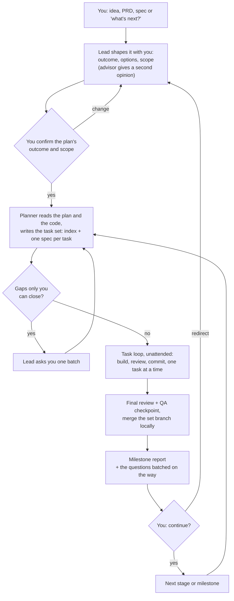
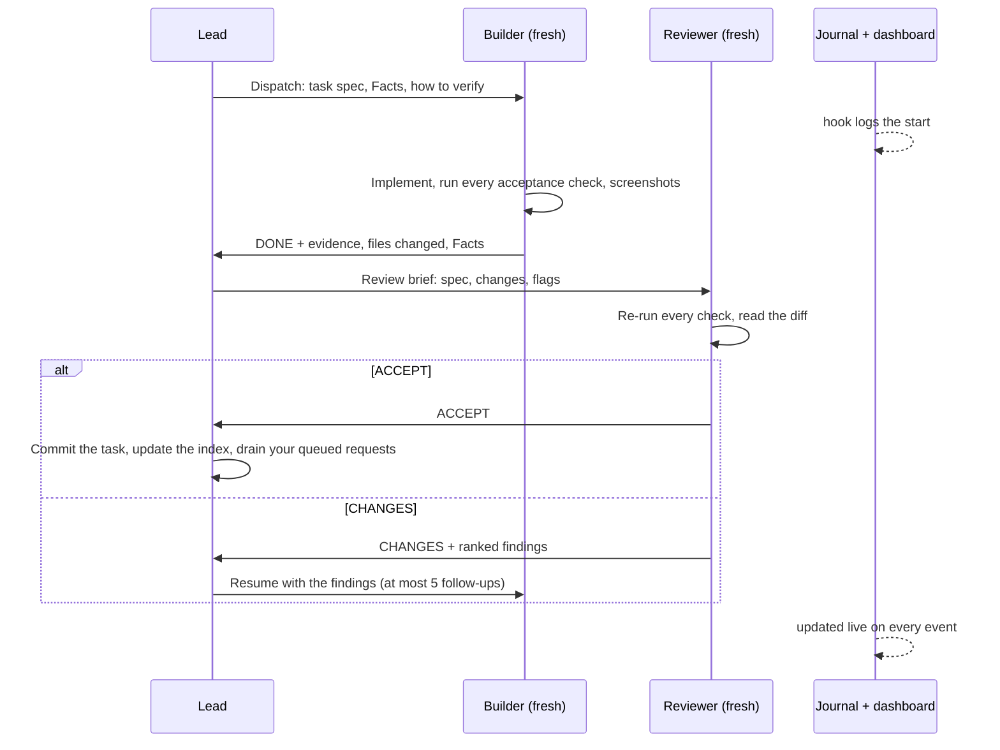
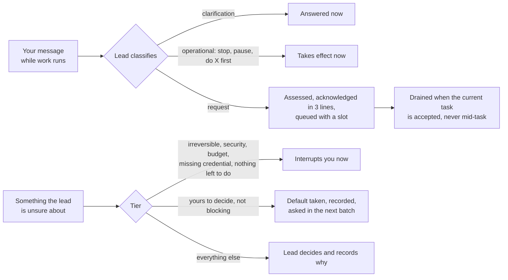
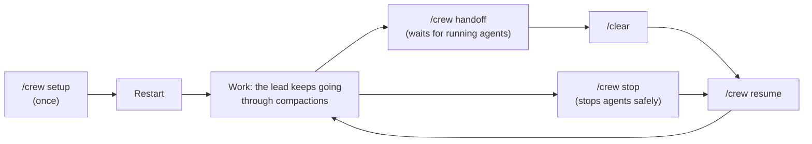

# crew

A multi-agent operating model for building software with Claude Code subagents, built to run unattended for long stretches. The main session acts as the **lead** of a small crew and the founder's steward: it plans with the founder, decomposes the work into verifiable tasks, decides which role, model and effort handles each one, briefs subagents, verifies what they land, queues the founder's mid-session requests, batches questions for the founder, and keeps its own context and cost down. A journal and a live web dashboard show the founder what the crew is doing. The goal is ergonomic software with few defects, at a sensible cost in money and time.

## How you work with the crew

You are the **founder**: you own the product's direction and taste. The main Claude Code session is the **lead**: it acts on your behalf, runs the crew, and decides everything not reserved for you, so it can keep working while you are away. You talk only to the lead; the subagents never ask you anything.

### Your part

| You | When |
| --- | --- |
| Run `/crew setup`, then restart the session | Once per project, and again after each skill update |
| Bring an idea, a PRD, a spec, or "what's next?" | Whenever you want; the lead shapes it into a plan with you |
| Confirm the plan's outcome and scope | Before any building starts |
| Answer the question batch (dialogs with the lead's default as the first option) | At each milestone, or when the crew runs out of unblocked work |
| Read the milestone report; say "continue" or redirect | At each milestone |
| Send requests or corrections | Any time: the lead acknowledges in 3 lines and queues them |
| Approve deploys, destructive data operations, pushes and spending above your budget posture | When the lead interrupts you for them |
| Keep the dashboard open (the URL the lead gives you when it starts it, or that `.crew/bin/crew status` prints; a Paseo side panel works well); skim `.crew/journal.md` | Whenever you like; nothing waits on it |
| Run `/crew stop`, then `/crew resume` | When you want everything stopped safely, and later continued in the same session |
| Run `/crew handoff`, `/clear`, `/crew resume` | When you want a fresh session |

### From idea to milestone



### One task, inside the loop



A failure the builder cannot fix in one attempt goes to a debugger, then to a stronger debugger, then back to the plan. Independent tasks may run in parallel, each builder in its own git worktree.

### Your messages and the lead's questions



If a request makes running work pointless, the lead stops those agents at once. Before reverting work already accepted, it asks you first.

### Sessions



The lead has no context-size threshold: it rolls over only when you run `/crew handoff`. State lives in files (`docs/CREW.md`, the state file, `.crew/`), so a fresh session picks up exactly where the last one stopped. Compactions are expected: a `CLAUDE.md` block, the skill's size and the compaction hooks keep the crew's rules in context, each compaction is journaled with its cost, and the dashboard's Compactions tab shows what each one saved, so you can tune the per-model compaction windows from real data (`reference/context.md`).

## What's inside

- **Roles** — lead, planner, scout, worker, builder, debugger, reviewer, QA and advisor, each with a default model and effort and a lifecycle (throwaway, resumed with at most 5 follow-ups, durable)
- **Routing** — who does what, with numeric triggers, and the debugging escalation ladder when a fix attempt fails
- **The crew standard method** — a plan that answers 8 questions, decomposed by the planner into a task set: an index plus one spec per task, each acceptance criterion with one method and a `Detects:` clause; flags (`judgement`, `cross-cutting`, `discovery`) that change how a task is briefed and reviewed; evidence-only statuses, demonstrated failures, a final outcome review and a reorient procedure. Any other planning framework can replace it
- **The founder** — three tiers (interrupt now, batch, decide and record), questions batched with defaults taken so work never stalls, and milestone reports
- **The request queue** — every founder message during work is classified, assessed, routed and acknowledged in 3 lines; requests are drained only at task-acceptance boundaries
- **Advisor** — a read-only second opinion from Fable at fixed triggers (vision, roadmap, milestone plans, costly-to-reverse decisions)
- **Briefs and reports** — templates for task dispatch, review, final review, debug escalation, QA, planning and advisor briefs, plus the milestone report
- **Quality** — tests that matter over test counts, QC checkpoints, and a screenshot review rubric
- **Deferred defects** — reviewers and QA mark each finding leaf or load-bearing; a first review is complete and re-reviews check only the fixes; leaf findings go to `.crew/defects.md` instead of another review round, briefs list them so agents don't chase them, one that bites other work is promoted, and the set's defects are fixed before its final review
- **Git and worktree discipline** — a branch per task set, a commit per accepted task, a local merge at set close, and parallel builders in worktrees with a lifecycle that prepares each worktree (`.crew/worktree/setup.sh`) and keeps its task data when it is removed
- **Journal and dashboard** — hooks log every subagent start, resume, finish and compaction to `.crew/journal.md`; a local web dashboard (Node, started with the session) shows the task set and its dependency graph, live agents, a Gantt chart of agent runs, timing (sleep, agent time, build / review / rework per task, the critical path and the parallel headroom), requests and questions, deferred defects, compactions (sizes, estimated overhead and savings) and the journal, and updates itself the moment a crew file changes
- **Keep awake** — `crew session start` holds a `caffeinate` assertion tied to the Claude Code process (macOS), so an unattended run doesn't stall on idle sleep; sleep that happens anyway is journaled and left out of the timing
- **Compaction strategy** — state in files, a `CLAUDE.md` block and a `SKILL.md` that carries every rule the lead must never lose (it is re-attached after a compaction), `PreCompact` instructions per role, a conditional post-compaction reminder, and a one-line request reminder while work is in flight; subagents never receive the lead's instructions
- **Task data** — screenshots, reports over the cap and logs per task in `.crew/task-data/<id>/`
- **Commands** — `/crew setup` (scaffolds `.crew/`, merges hooks and settings, installs the agents, writes `docs/CREW.md`), `/crew handoff` and `/crew resume` for session rollover, `/crew stop` to stop every subagent safely (and `/crew resume` to continue)
- **Progressive disclosure** — `SKILL.md` holds the rules the lead applies unprompted; everything needed only at a trigger loads then, from `reference/` and `commands/` (see [Editing this skill](#editing-this-skill))

### The dashboard

A local web page, served by `.crew/dashboard/server.mjs` (Node.js, no dependencies at run time) on `127.0.0.1` at a port that stays the same for a project, so it can live in a browser tab or a Paseo side panel. The session-start hook starts it, and the lead opens its first reply with `Open the dashboard at <url>`; when one was already running for the project (started by another session, by you, or by a Paseo panel) it says nothing. `.crew/bin/crew status` prints its URL, and `.crew/bin/crew dashboard start|stop|restart|url` manages it (`start` exits 3, silently, when one is already running). It is built for a narrow panel and follows the system's light or dark theme. The header shows the project's own icon when the repository has a square one (a favicon, an app icon or a logo); a click switches to crew's mark and back, remembered per project.

It reads the same files the crew writes (the task-set indexes and specs, `queue.md`, `defects.md`, `handoff.md`, the journal, the hook state and git) and pushes a fresh state to the page over server-sent events whenever one of them changes: no polling, and no reload, so the scroll position, the open tab and any open panel stay put. Running durations tick every second in the page (`02:53:22`, colons blinking) and freeze when the run ends (`1h 19m`); sleep and other closed intervals never tick. Each new journal line shows as a notice at the top for 10 seconds; notices stack, and a click opens the Journal.

| Tab | What it shows |
| --- | --- |
| Overview | The current set's progress and stage, the task being worked on, the lead's state (working, waiting for you, stopped), live agents, counts of open questions, requests, defects and compactions, the time on the clock, keep-awake, the last handoff and recent activity |
| Tasks | The dependency graph with the critical path highlighted, and every task with its status, flags, phase time and agents; a task opens its spec, runs and screenshots |
| Timing | Sleep, agents at work, and the lead and waiting; a zoomable Gantt chart of every agent run (a bar opens its task); build, review and rework per task; the critical path and the parallel headroom; time by role |
| Requests | Your open questions first, then queued, scheduled, done and dropped requests |
| Defects | Deferred, scheduled, fixed and promoted counts, and the open and closed entries |
| Compactions | Lead and subagent compactions: context before and after, and estimated overhead, savings and net per compaction |
| Journal | The journal, newest first, filtered by lead, agents or system, with search |
| Sets | Every task set found, including those in worktrees; each opens its index |

Set `CREW_DASHBOARD=0` in the environment to keep it from starting. Without Node.js 20 or later, everything else works and the dashboard is skipped.

### The `.crew/` layout in a project

```
docs/CREW.md                 committed (project facts and deviations from the defaults)
.claude/agents/*.md          committed
.claude/settings.json        committed (hooks, permission rule, worktree.baseRef)
.crew/README.md              committed
.crew/bin/crew               committed (the crew script)
.crew/templates/*.md         committed (task spec and index templates)
.crew/worktree/*.sh          committed (the project's worktree setup and teardown)
.crew/queue.md               committed (founder requests and questions)
.crew/defects.md             committed (deferred defects)
.crew/handoff.md             committed (written by /crew handoff)
.crew/plans/<slug>.md        committed
.crew/tasks/<slug>/          committed (index.md and NN-<slug>.md specs)
.crew/journal.md             gitignored (history, for the founder)
.crew/dashboard/             gitignored (the dashboard server and page, installed by /crew setup)
.crew/task-data/<id>/        gitignored (screenshots/, reports/, logs/ per task)
.crew/tmp/                   gitignored (lock, hook state, the dashboard's port and log)
.claude/worktrees/           gitignored
```

## Requirements

- **`jq`** — a hard requirement for the hooks. `/crew setup` installs it if it is missing and aborts if it cannot.
- **Claude Code v2.1.292 or later** for per-call effort overrides on the Agent tool. Older versions work, with a warning, without them.
- **git** — expected. Without it, set `Git: none` in `CREW.md`: no branches, no commits, no parallel worktrees.
- **Node.js 20 or later** — for the dashboard only. Without it the crew runs as usual and the dashboard is skipped.

## Install

```sh
aitools install @gh/claudio-silva/ai-toolbox crew
npx skills add claudio-silva/ai-toolbox --skill crew -a claude-code   # alternative
```

Claude Code only (`aitools.json` sets `platforms`): the roles rely on Claude Code subagents, the Agent tool's `model`/`effort` overrides, and Claude model names. See the [repository README](../../../README.md).

## Contents

| Path | Purpose |
| --- | --- |
| `SKILL.md` | The lead's core: commands, session start, the work loop, roles, routing, lifecycle, briefs, quality, context, journal, and the Read-when table |
| `commands/setup.md` | `/crew setup`: prerequisites, scaffold, `.gitignore`, settings and hooks, agents, `CREW.md`, verification |
| `commands/handoff.md` | `/crew handoff`: wait for running work, write `.crew/handoff.md` |
| `commands/resume.md` | `/crew resume`: read the handoff, check HEAD, continue (after a handoff or after `/crew stop`) |
| `commands/stop.md` | `/crew stop`: stop every running subagent safely, record where things are, report |
| `reference/founder.md` | The three tiers, batched questions and default-taking, the question timeout, milestones |
| `reference/requests.md` | Handling founder messages during work: classify, assess, route, acknowledge; the queue; draining |
| `reference/planning.md` | From idea, brainstorm or PRD to a confirmed plan; framework selection; what a crew plan must answer |
| `reference/execution.md` | Running a task set: branches and commits, the serial loop, parallel worktrees, closing, reorient |
| `reference/briefs.md` | Brief and report templates |
| `reference/roles.md` | Role cards, the model facts snapshot behind each choice, and how to refresh it |
| `reference/testing.md` | Testing policy, QC checkpoints, screenshot review rubric |
| `reference/context.md` | The lead's context and cost economics, where state lives, what survives a compaction and how to read the compaction numbers |
| `scaffold/README.md` | Copied to `<project>/.crew/README.md`: what each file is, the journal, the dashboard |
| `scaffold/queue.md` | The empty request and question queue |
| `scaffold/defects.md` | The empty defect log |
| `scaffold/bin/crew` | The crew script: journal, hook handlers, the state the dashboard reads, session registration, request queue, defect log, keep awake, starting the dashboard, worktree setup and teardown |
| `scaffold/dashboard/` | Copied to `<project>/.crew/dashboard/`: the dashboard server (`server.mjs`), the model that turns crew files into its state (`model.mjs`), and the built page (`app/`) |
| `scaffold/templates/task.md` | Task spec template |
| `scaffold/templates/index.md` | Task-set index template |
| `scaffold/worktree/setup.sh` | The project's worktree setup (setup fills the marked section) |
| `scaffold/worktree/teardown.sh` | The project's worktree teardown (a no-op by default) |
| `templates/agents/*.md` | Subagent definitions copied into `<project>/.claude/agents/` by setup (advisor, builder, debugger, planner, qa, reviewer, scout, worker) |
| `templates/CREW.md` | Template for the per-project rules file (deviations only) |
| `templates/settings.json` | Hooks, the permission rule and `worktree.baseRef`, merged into `<project>/.claude/settings.json` |
| `dashboard/` | Source of the dashboard page (Vite, React, Tailwind, shadcn, ECharts). `npm install`, then `npm run build` writes `scaffold/dashboard/app/`; `npm run dev` serves it with hot reload against a running dashboard. Not installed |
| `tests/hooks.sh` | Fixture tests for the crew script and the dashboard model (hooks, compactions, requests, defects, timing, reminders); not installed |
| `tests/dashboard.test.mjs` | Tests for the dashboard parsers and the live server (`node --test tests/`); not installed |
| `aitools.json` | Install metadata: Claude Code only; leaves `tests/` and `dashboard/` out |

## Editing this skill

- **`SKILL.md` carries every rule the lead must apply unprompted:** on every turn, at every step of the work loop, or on an event it would otherwise miss (a founder message, a returned report, a compaction). Claude Code re-attaches an invoked skill's body after a compaction, so these rules survive whether or not a hook fires or a reminder to re-read is followed. Never move such a rule out of `SKILL.md` to make it shorter.
- **Everything else loads at its trigger (progressive disclosure):** procedures, templates, checklists, rationale, examples and edge cases go in `reference/` or `commands/`, each with a Read-when row saying when to read it. `SKILL.md` keeps the rule and points to the detail; it never copies the detail in.
- **5,000 tokens is an absolute limit for the body of `SKILL.md`.** Claude Code keeps only the first 5,000 tokens of a skill when it re-attaches it after a compaction, so anything past that is lost exactly when it matters. `tests/skill-size.sh` checks it with a conservative estimate (characters ÷ 3.5). Within the limit, judge each line by when the lead needs it, not by how short the file could be.
- **Sections in order of importance, in a logical sequence:** session start, the work loop, founder requests, routing, briefs, quality, then the Read-when table, and last the reference sections (roles, lifecycle, context, journal). A new rule goes where its importance puts it, not at the end.
