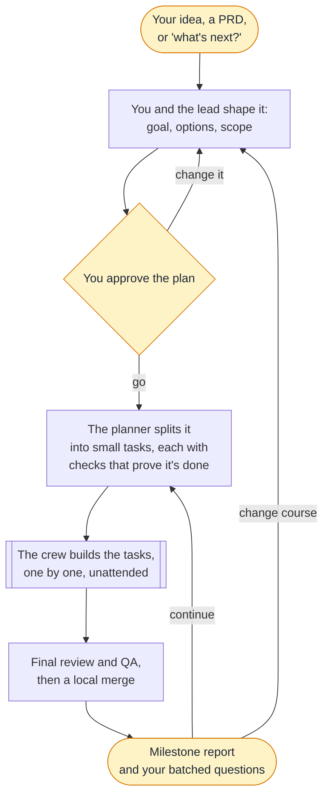
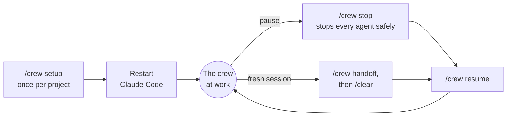

# Crew

**A software team inside Claude Code.** Crew makes your Claude Code session the lead of a small crew of specialist agents. You bring the idea. The lead plans it with you, then the crew builds it one task at a time: each task is built, reviewed independently, tested and committed. It keeps going for hours while you're away, and a live dashboard on your desktop or your phone shows what it's doing.

[Why Crew](#why-crew) · [Getting started](#getting-started) · [Learn more](#learn-more) · [Commands](#commands) · [How it works](#how-it-works) · [The dashboard](#the-dashboard) · [Memory and context](#memory-and-context) · [Configuration](#configuration) · [Status: alpha](#status-alpha)

## Why Crew

- **It keeps working while you're away.** The lead makes every decision that isn't yours to make. For the ones that are, it takes a sensible default, writes it down, and saves the question for one batch at the next milestone. Nothing waits on you, and on a Mac the computer stays awake while the crew works.
- **Every task is checked before it's committed.** Each task's acceptance checks are written before any code. A fresh reviewer, who never saw the builder's reasoning, reruns every check and reads the diff. Reports need evidence, such as test output and screenshots.
- **The right model for every job.** Opus where judgement matters: leading, planning, reviewing. Sonnet builds at half Opus's price. Haiku reads, searches and makes bulk edits for a fraction of that. Fable gives a second, independent opinion before decisions that are costly to reverse.
- **You stay in charge without watching over it.** Talk to the lead at any time. It acknowledges each request in three lines, queues it, and applies it between tasks, never in the middle of one. It interrupts you only for what it must not decide alone: a production deploy, a force-push, a destructive data change, spending over budget, a security risk.
- **You see everything as it happens.** Progress, running agents, a timeline of every agent run, the critical path, open defects, what each context compaction cost, and the full journal. On your phone too: scan a QR code.
- **A clean git history.** One branch per set of tasks and one commit per accepted task. Independent tasks are built in parallel, each in its own git worktree, then merged locally. Nothing is pushed without your approval.
- **Built for long sessions.** State lives in files and the rules survive context compaction, so the lead keeps working through it. Contexts stay small by design, and the dashboard shows whether your compaction settings fit your project ([Memory and context](#memory-and-context)). When you want a fresh session, `/crew handoff` and `/crew resume` pick up exactly where it stopped.
- **Works with your planning method.** Crew comes with its own (small tasks, each with checks that prove it's done), and you can use any other.

---

> **Crew is for Claude Code only!** It has been carefully tuned to Claude's models and to the way Claude Code works:
>
> - **Claude's models.** Each role's model and effort was chosen from the benchmarks and prices of the Claude models. The same prices decide when an agent is reused and when a fresh one takes over: Haiku's price, for one, rises fivefold past 100K tokens of context.
> - **Claude Code's machinery.** Crew runs on Claude Code's subagents, with a model and an effort for each, and on its hooks, which track every agent and every compaction. It also relies on agents that can be resumed, git worktrees for parallel builders, and prompt caching.
> - **Claude Code's limits.** The skill is written around them. For example, its core rules fit in the 5,000 tokens of a skill that Claude Code keeps through a compaction.
>
> Making Crew work with another provider wouldn't be a matter of settings. It would mean redoing that tuning for other models, other prices and other agent tools.
>
> See the [repository README](../../../README.md) for other skills in this collection that target other providers (e.g. Codex).


## Getting started

**1. Check the requirements.**

| Requirement | Why |
| --- | --- |
| Claude Code v2.1.292 or later | Lets the lead raise an agent's effort for harder work. Older versions work, without that. |
| git | Branches, commits and parallel builds. Without it, the crew still works, with none of those. |
| jq | The crew's hooks need it. `/crew setup` installs it if it's missing. |
| Node.js 20 or later | Only for the dashboard. Everything else works without it. |

**2. Install the skill.**

```sh
aitools install @gh/claudio-silva/ai-toolbox crew
# or
npx skills add claudio-silva/ai-toolbox --skill crew -a claude-code
```

**3. Set up your project.** In Claude Code, at the root of your project, run:

```
/crew setup
```

Setup lists every change it's about to make, then adds the crew's agents, hooks and files to the project ([what it adds](#what-setup-adds-to-your-project)). It asks only what it can't learn from the repository. Then **restart Claude Code** so the hooks and agents load. Run setup again after each skill update.

**4. Pick the lead's model.** Run the main session on **Opus 5.5 at High effort** (`/model`). The lead's work is judgement: plans, routing, reviews, decisions. It hands the bulk work to cheaper models.

**5. Tell the lead what you want.** Plain words are enough:

> I want readers to export a book to EPUB. Let's plan it.

> Here's the PRD for v2: …

> What's next?

The lead works out the goal and the scope with you, asks its questions up front, and gets the crew going once you confirm the plan.

**6. Open the dashboard.** The lead's first reply starts with *Open the dashboard at http://…* (or run `.crew/bin/crew status`). Keep it in a browser tab or a Paseo side panel. To follow along on your phone, click the QR code button in its header and scan it.

**7. Walk away.** When you come back, you'll find a milestone report and a short batch of questions. Say "continue", or change course.

## Learn more

This page is the overview. Crew's whole playbook is open to read: the guides below are the ones the lead itself follows, so they describe exactly what it will do. They speak to the lead, and call you "the founder".

| | Guide | What you'll find |
| --- | --- | --- |
| **Planning and building** | [Planning](reference/planning.md) | From an idea, a brainstorm or a PRD to a confirmed plan; choosing a planning method; how a plan becomes small tasks that can be checked |
| | [Execution](reference/execution.md) | Running a set of tasks: branches and commits, the build and review loop, which findings wait and which are fixed now, parallel builders, closing a set |
| | [Testing and QC](reference/testing.md) | Which tests are worth writing, interactive QA in the real UI, checkpoints, and how screenshots are reviewed |
| **Working with you** | [Questions and milestones](reference/founder.md) | What the lead decides alone, what it asks you and when, how questions are batched with defaults, and the milestone report |
| | [Requests while work runs](reference/requests.md) | How each message you send is assessed, routed, acknowledged and queued |
| **The team and its costs** | [Roles and models](reference/roles.md) | Each role's job, and the model facts and prices behind every choice |
| | [Context and cost](reference/context.md) | Why context size drives cost, where state lives, what survives a compaction, and how to read the compaction numbers |
| | [Briefs and reports](reference/briefs.md) | The briefs the lead gives each role, and the report you get at each milestone |
| **In your project** | [The `.crew/` folder](scaffold/README.md) | Every file setup adds, the journal, the dashboard in depth, task data and worktrees (also in your project, at `.crew/README.md`) |
| | Commands: [setup](commands/setup.md) · [stop](commands/stop.md) · [resume](commands/resume.md) · [handoff](commands/handoff.md) | What each command does, step by step |
| **Working on Crew** | [DEVELOPING.md](DEVELOPING.md) | Building the dashboard, running the tests, and the rules for editing the skill |

## Commands

| Command | What it does |
| --- | --- |
| `/crew setup` | Prepares the project. Run it once, and again after each skill update. |
| `/crew stop` | Stops every running agent safely and records where things stand. |
| `/crew resume` | Continues after a stop, or in a fresh session after a handoff. |
| `/crew handoff` | Waits for running work and writes a handoff note. Then `/clear` and `/crew resume`. |
| `.crew/bin/crew status` | Prints the dashboard's address, starting the dashboard if needed. |

## How it works

### From idea to milestone



The yellow steps are yours. Before decisions that are costly to reverse, such as the roadmap, a milestone plan or the architecture, the lead asks the advisor for a second opinion.

### The life of a task


- **Small issues don't block a task.** A minor finding that no other work depends on is logged as a defect and fixed before the set closes, so it doesn't cost another review round. One that gets in the way of other work is fixed at once.
- **Independent tasks can run in parallel,** each builder in its own git worktree.
- **Every step appears on the dashboard as it happens.**

### Meet the crew

| Role | Model · effort | What it does |
| --- | --- | --- |
| **Lead** | Opus · high | Your main session. Plans with you, assigns the work, checks the results, makes the decisions, talks to you. |
| **Planner** | Opus · high | Splits a plan into tasks with acceptance checks, after reading the real code. |
| **Builder** | Sonnet · medium (high for judgement calls) | Implements a task and the tests that matter for it. |
| **Reviewer** | Opus · medium | Checks every task independently, and never reviews its own work. |
| **Debugger** | Sonnet · high, escalating to Opus · xhigh | Takes over a failure that survived one fix attempt. |
| **QA** | Sonnet · medium (Haiku for scripted runs) | Drives the real UI: key user journeys, exploratory sessions, screenshots. |
| **Scout** | Haiku · medium | Reads, searches and summarises, so the lead's own context stays small. |
| **Worker** | Haiku · high | Mechanical bulk changes: renames, moves, sweeps. |
| **Advisor** | Fable · high | A second opinion on the vision, the roadmap and costly-to-reverse decisions. |

### Talking to the crew while it works

| You say… | The lead… |
| --- | --- |
| A question, such as "why did you choose X?" | Answers right away. |
| "Stop", "do X first" | Does it now. |
| Anything that changes what gets built, such as "make the button blue" or "also add export" | Replies in three lines: what it understood, what it affects and costs, and when it will happen. Then it queues the request and applies it once the current task is accepted. |

If a request makes running work pointless, the lead stops those agents at once. Before undoing work already accepted, it asks you.

| When the lead is unsure about… | It… |
| --- | --- |
| Something irreversible (a deploy, a force-push, destroying data), a security risk, spending over budget, a missing credential, or no work left | Asks you right away. |
| Something that's yours to decide, but not blocking | Takes a sensible default, writes it down, and asks you in the next batch. |
| Anything else | Decides, and records why. |

### Sessions



The lead never runs out of room. When its context fills up, Claude Code compacts it and the crew's rules come back with it (via hooks), so it simply carries on. A fresh session is your call, not a necessity. See [Memory and context](#memory-and-context).

## The dashboard

A live page for following the crew, in a browser tab, a Paseo side panel or on your phone. It updates the moment something changes, with no reload, and running clocks tick in real time. It has light and dark theme support, and its header shows your project's name and icon, when it has one; click it to switch to Crew's own icon.

| Tab | What it shows |
| --- | --- |
| **Overview** | The current set's progress, the task in hand, the lead's state, running agents, questions waiting for you, requests, defects, the crew's time at work, and recent activity |
| **Tasks** | The dependency graph with the critical path highlighted; each task opens its spec, its agent runs and its screenshots |
| **Timing** | Where the time went (agents, the lead alone, idle, asleep), a zoomable timeline of every agent run, build, review and rework per task, and time by role |
| **Requests** | Your open questions first, then your requests: queued, scheduled, done and dropped |
| **Defects** | Minor issues logged for later, when each is due, and a legend for every label |
| **Compactions** | Every context compaction: size before and after, and its estimated cost and savings, to [tune the windows](#tuning-compaction-for-your-project) |
| **Journal** | Everything the crew did, newest first, searchable |
| **Sets** | Every set of tasks, including those in other worktrees |

**On your phone or tablet.** The address the lead gives you works from any device on the same Wi-Fi or Tailscale network, and the QR code button shows it as a code to scan. The address includes a private key for the project, so other people on the network can't read it. If the crew runs on a remote server, open the dashboard through an SSH tunnel, `ssh -N -L <port>:127.0.0.1:<port> <server>`, then `http://127.0.0.1:<port>/`, with no key.

## Memory and context

Every agent works inside its context: everything it has read and said so far, sent again with each request. A larger context costs more on every request, and when it fills up, Claude Code compacts it into a summary that loses some detail. Crew is built so that neither hurts: what matters is kept in files, contexts stay small, and you tune compaction to your project with real numbers.

### What the crew remembers

The crew's long-term memory is in files, not in any agent's head: the plans, the tasks and their status, your requests and answers, the decisions taken, the defect log and the handoff note, all committed to git. Any agent can forget safely, the lead included, after a compaction or in a new session, and pick up exactly where things stood.

The crew's rules stay with the lead through every compaction: Claude Code attaches the skill again, and Crew's hooks tell the summary what to keep (your queued requests, the task statuses, the running agents, the next step).

QA also remembers across sessions: what it learns about driving your app is kept, and grows with every run.

### Small contexts by design

Compaction is the last resort. Crew keeps contexts from growing in the first place:

- **The lead reads conclusions, not files.** Scouts do the reading and searching and report back a summary. Reports have a word limit, and long output goes to files.
- **A fresh agent for each job.** Each task gets a new builder with a complete brief, and then a new reviewer. A fresh agent starts small, costs the least, and carries no bias from earlier work.
- **The same agent, when that's cheaper.** The builder that wrote a task fixes its own review findings, because it already knows the code. A Sonnet or Opus agent can also take a follow-up task on files it just changed. After 5 follow-ups, it's retired and a fresh agent takes over from a summary.
- **Haiku agents always start fresh.** Haiku's price rises fivefold past 100K tokens of context, so scouts and workers get new work only as new agents.

### Tuning compaction for your project

When a context nears its model's *compaction window*, Claude Code summarises it and carries on. It compacts about 33K tokens before the window is full, to leave room for the summary: a 200K window compacts at about 167K. Each compaction costs one summarising request and makes every later request cheaper. A window that's too small compacts too often: the summaries cost more than they save, and agents lose detail and read files again. A window that's too large makes every request pay for context that's no longer needed. The right size depends on your project: the size of its code, of its tasks, and of what the agents must read.

**The Compactions tab tells you whether your windows fit.** It lists every compaction, the lead's and the agents', with the context size before and after, what the summary cost, what it has saved since, and the net.

| On the Compactions tab | It means | So |
| --- | --- | --- |
| Most of a role's rows have a net at or below zero, or few turns after | That model compacts too early for the work it does | Raise that model's window |
| Builders compact in the middle of a task | The tasks are too big for one context, or the window is too small | Ask for smaller tasks first, then raise the Sonnet window |
| The lead compacts rarely, at a very large size | Every request pays for context the lead no longer uses | Lower the lead's window: with state in files, the summary loses little |

**Setting the windows.** A window belongs to a model, and it applies to the lead and to every crew agent running on that model. Set them in a settings file, which the CLI and the desktop app both read (Claude Code v2.1.288 or later). These are the recommended starting points, to adjust from what the Compactions tab shows:

| Model | Crew roles | Window | Compacts at about |
| --- | --- | --- | --- |
| Haiku | Scout, worker, scripted QA | 100K | 67K |
| Sonnet | Builder, debugger, QA | 200K | 167K |
| Opus | Lead, planner, reviewer, hard debugging | 300K | 267K |
| Fable | Advisor | 400K | 367K |

```json
{
  "modelSettings": {
    "claude-haiku-5-5":  { "autoCompactWindow": 100000 },
    "claude-sonnet-5-5": { "autoCompactWindow": 200000 },
    "claude-opus-5-5":   { "autoCompactWindow": 300000 },
    "claude-fable-5-1":  { "autoCompactWindow": 400000 }
  }
}
```

| File | Applies to |
| --- | --- |
| `~/.claude/settings.json` | All your projects |
| `.claude/settings.json` in the project | Everyone working on the project (committed) |
| `.claude/settings.local.json` in the project | You, in this project only; it wins over the other two |

Values are in tokens, from 100,000 to 1,000,000, and never above the model's own context size. Remember the 33K margin: to compact at about 250K, set 283,000. Restart Claude Code after editing a settings file.

Other ways to set them:

- **`/autocompact 300k`** in a CLI session sets the window of the model you're on, the lead's, and saves it in your user settings. Crew agents on the same model (with an Opus lead, the planner and the reviewer) use it too. The other models still need the settings file.
- **`autoCompactWindow: 150000`** in the frontmatter of one role's definition, such as `.claude/agents/builder.md`, gives that role a smaller window than its model's (v2.1.296 or later). It can only lower the window. Write the full number: `150k` doesn't work there.
- **`claude --autocompact 500k`** sets a window for one launch, without saving it. The `CLAUDE_CODE_AUTO_COMPACT_WINDOW` environment variable overrides all of the above, per-role windows included.

## Configuration

- **`docs/CREW.md`** holds your project's own rules: facts about the project and anything that differs from the crew's defaults. It overrides the skill. Setup writes it with you.
- **The question timeout.** Setup offers to give the lead's questions 10 minutes. If you don't answer in time, the lead takes its default and moves on.
- **Compaction windows**, per model: see [Tuning compaction](#tuning-compaction-for-your-project).
- **Environment variables:**
  - `CREW_DASHBOARD=0`: don't start the dashboard.
  - `CREW_DASHBOARD_LAN=0`: keep the dashboard on this computer only.
  - `CREW_KEEP_AWAKE=0`: let the computer sleep.

### What setup adds to your project

| | What | Where |
| --- | --- | --- |
| **Committed** (shared with your team) | Your project's crew rules | `docs/CREW.md` |
| | A short pointer block | `CLAUDE.md` |
| | The crew's agents | `.claude/agents/` |
| | Hooks and a permission rule, merged into your settings | `.claude/settings.json` |
| | Plans, sets of tasks, the request queue, the defect log, the handoff note, the crew script and its templates | `.crew/` |
| **Not committed** | The journal, the dashboard, screenshots and logs per task, scratch state | `.crew/` (gitignored) |

## Status: alpha

> [!WARNING]
> Crew is in alpha. It's under active development and changes often, and things will break from time to time. If you choose to use it anyway, expect that.

An update can change the commands, the files in `.crew/` or the dashboard. To keep surprises small:

- Run `/crew setup` after every update. It merges the changes into your project.
- Update between sets of tasks, not in the middle of one.
- [Report what breaks](https://github.com/claudio-silva/ai-toolbox/issues). It's how Crew gets out of alpha.

## Contributing

Bug reports, ideas and pull requests are welcome.

- **Report a problem or suggest an idea** by [opening an issue](https://github.com/claudio-silva/ai-toolbox/issues). For a problem, include your Claude Code version, what you asked the lead, and, if you can share them, the relevant lines of `.crew/journal.md`.
- **Change Crew itself:** [DEVELOPING.md](DEVELOPING.md) explains how to build the dashboard, run the tests, and edit the skill without breaking its rules. The repository's [CONTRIBUTING.md](../../../CONTRIBUTING.md) covers the conventions every tool here shares.
- Contributions are accepted under the Apache License 2.0, like the rest of Crew.

## Author

Crew is created and maintained by **Cláudio Silva** ([@claudio-silva](https://github.com/claudio-silva)).

## License

Copyright © 2026 Cláudio Silva.

Licensed under the [Apache License, Version 2.0](LICENSE). You may use, modify and share Crew, including commercially, as long as you keep the copyright and license notices. It comes with no warranty.
