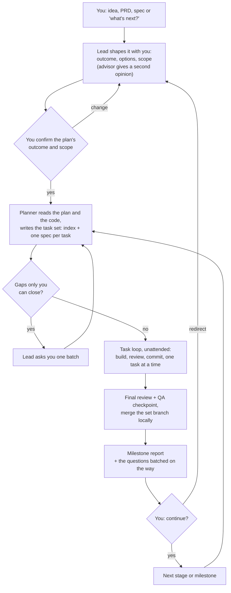
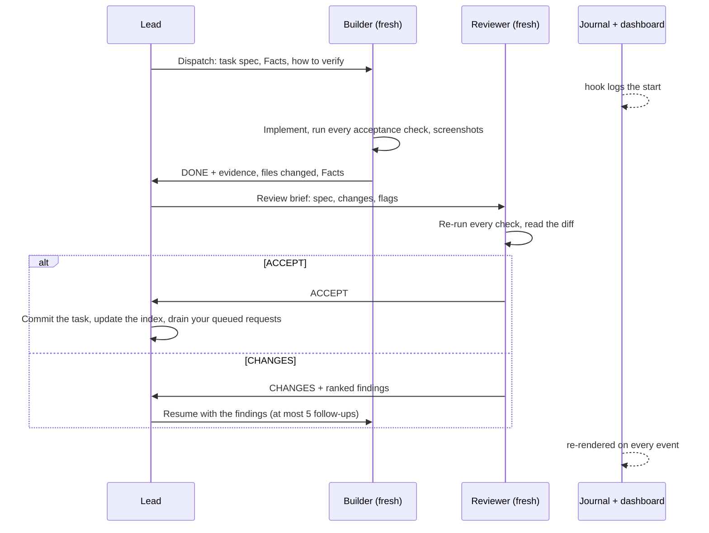
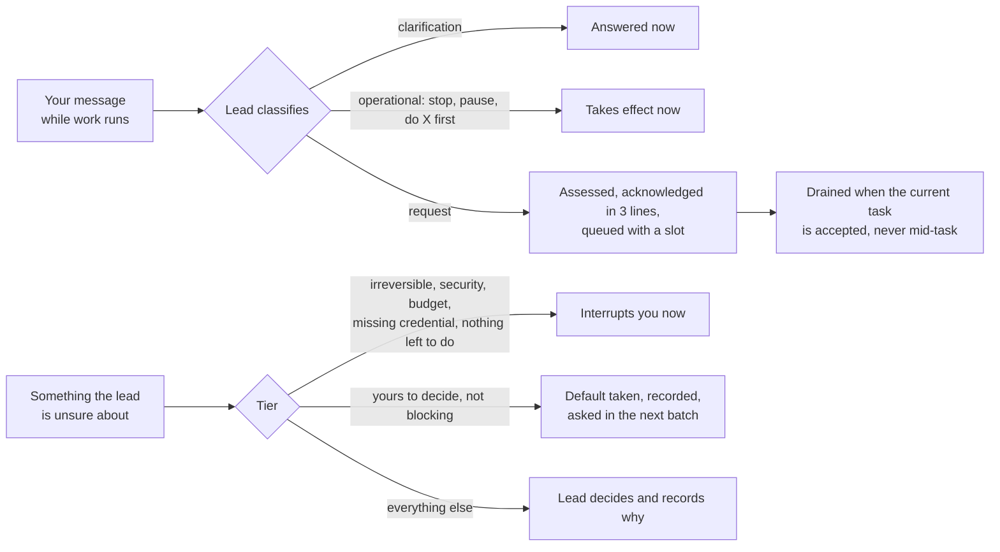
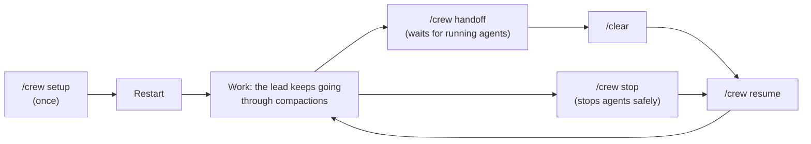
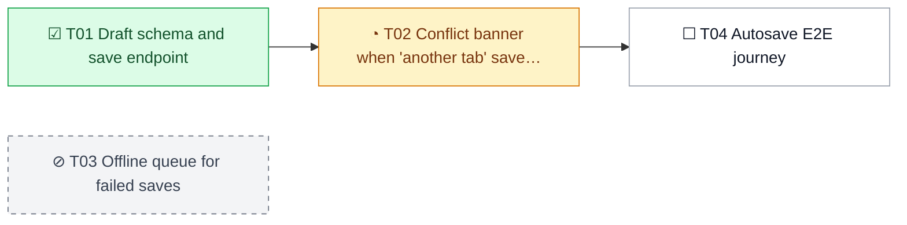

# crew

A multi-agent operating model for building software with Claude Code subagents, built to run unattended for long stretches. The main session acts as the **lead** of a small crew and the founder's steward: it plans with the founder, decomposes the work into verifiable tasks, decides which role, model and effort handles each one, briefs subagents, verifies what they land, queues the founder's mid-session requests, batches questions for the founder, and keeps its own context and cost down. A journal and a live status dashboard show the founder what the crew is doing. The goal is ergonomic software with few defects, at a sensible cost in money and time.

## How you work with the crew

You are the **founder**: you own the product's direction and taste. The main Claude Code session is the **lead**: it acts on your behalf, runs the crew, and decides everything not reserved for you, so it can keep working while you are away. You talk only to the lead; the subagents never ask you anything.

### Your part

| You | When |
| --- | --- |
| Run `/crew setup`, then restart the session | Once per project, and again after each skill update |
| Bring an idea, a PRD, a spec, or "what's next?" | Whenever you want; the lead shapes it into a plan with you |
| Confirm the plan's outcome and scope | Before any building starts |
| Answer the question batch (dialogs with the lead's default as the first option) | At each milestone, or when the crew runs out of unblocked work |
| Read the milestone report; say "continue" or redirect | At each milestone |
| Send requests or corrections | Any time: the lead acknowledges in 3 lines and queues them |
| Approve deploys, destructive data operations, pushes and spending above your budget posture | When the lead interrupts you for them |
| Watch `.crew/status.md`; skim `.crew/journal.md` | Whenever you like; nothing waits on it |
| Run `/crew stop`, then `/crew resume` | When you want everything stopped safely, and later continued in the same session |
| Run `/crew handoff`, `/clear`, `/crew resume` | When you want a fresh session |

### From idea to milestone



### One task, inside the loop



A failure the builder cannot fix in one attempt goes to a debugger, then to a stronger debugger, then back to the plan. Independent tasks may run in parallel, each builder in its own git worktree.

### Your messages and the lead's questions



If a request makes running work pointless, the lead stops those agents at once. Before reverting work already accepted, it asks you first.

### Sessions



The lead has no context-size threshold: it rolls over only when you run `/crew handoff`. State lives in files (`docs/CREW.md`, the state file, `.crew/`), so a fresh session picks up exactly where the last one stopped. Compactions are expected: a `CLAUDE.md` block, the skill's size and the compaction hooks keep the crew's rules in context, each compaction is journaled with its cost, and the dashboard's Compactions section shows what each one saved, so you can tune the per-model compaction windows from real data (`reference/context.md`).

## What's inside

- **Roles** — lead, planner, scout, worker, builder, debugger, reviewer, QA and advisor, each with a default model and effort and a lifecycle (throwaway, resumed with at most 5 follow-ups, durable)
- **Routing** — who does what, with numeric triggers, and the debugging escalation ladder when a fix attempt fails
- **The crew standard method** — a plan that answers 8 questions, decomposed by the planner into a task set: an index plus one spec per task, each acceptance criterion with one method and a `Detects:` clause; flags (`judgement`, `cross-cutting`, `discovery`) that change how a task is briefed and reviewed; evidence-only statuses, demonstrated failures, a final outcome review and a reorient procedure. Any other planning framework can replace it
- **The founder** — three tiers (interrupt now, batch, decide and record), questions batched with defaults taken so work never stalls, and milestone reports
- **The request queue** — every founder message during work is classified, assessed, routed and acknowledged in 3 lines; requests are drained only at task-acceptance boundaries
- **Advisor** — a read-only second opinion from Fable at fixed triggers (vision, roadmap, milestone plans, costly-to-reverse decisions)
- **Briefs and reports** — templates for task dispatch, review, final review, debug escalation, QA, planning and advisor briefs, plus the milestone report
- **Quality** — tests that matter over test counts, QC checkpoints, and a screenshot review rubric
- **Git and worktree discipline** — a branch per task set, a commit per accepted task, a local merge at set close, and parallel builders in worktrees with a lifecycle that prepares each worktree (`.crew/worktree/setup.sh`) and keeps its task data when it is removed
- **Journal and dashboard** — hooks log every subagent start, resume, finish and compaction to `.crew/journal.md`; `.crew/status.md` is a Markdown and Mermaid dashboard re-rendered on every crew event, with a Compactions section (counts, sizes, intervals, estimated overhead and savings per compaction)
- **Compaction strategy** — state in files, a `CLAUDE.md` block and a `SKILL.md` small enough to be re-injected, `PreCompact` instructions per role, a conditional post-compaction reminder, and a one-line request reminder while work is in flight; subagents never receive the lead's instructions
- **Task data** — screenshots, reports over the cap and logs per task in `.crew/task-data/<id>/`
- **Commands** — `/crew setup` (scaffolds `.crew/`, merges hooks and settings, installs the agents, writes `docs/CREW.md`), `/crew handoff` and `/crew resume` for session rollover, `/crew stop` to stop every subagent safely (and `/crew resume` to continue)
- **Progressive disclosure** — `SKILL.md` holds what the lead needs at every step; everything else loads only at its trigger

### The status dashboard

`.crew/status.md` opens in any Markdown preview that renders Mermaid (Paseo, GitHub, VS Code, Cursor, Obsidian). A shortened sample:

---

# Crew status — sublimewriter

*Updated 2026-10-20 14:16 · crew/autosave @ 716651d · ▶ agents working, lead idle*

## Now

**Autosave and conflict handling** · `tasks/autosave/index.md`

███░░░░░░░░░ 1/4 accepted

- **Current task:** ◔ T02 Conflict banner when 'another tab' saved first — in progress — builder (sonnet · high) [banner]
- **Open founder questions:** 1 · **Queued requests:** 1

## Tasks



| # | Status | Task | Flags | Depends on | Agent now |
|---|---|---|---|---|---|
| T01 | ☑ accepted | Draft schema and save endpoint | — | — | — |
| T02 | ◔ in progress | Conflict banner when 'another tab' saved first | judgement | T01 | builder (sonnet · high) [banner] |
| T03 | ⊘ blocked | Offline queue for failed saves | discovery | — | — |
| T04 | ☐ pending | Autosave E2E journey | — | T02 | — |

## Requests and questions

| ID | Request | Affects | Slot | Status |
|---|---|---|---|---|
| R1 | Migrate D1 to Neon | data layer, T03 | milestone 2 | queued |

| ID | Question for the founder | Default taken | Status |
|---|---|---|---|
| F1 | Keep drafts for 30 or 90 days? | 30 days | open |

## Live agents

| Agent | Model · effort | Name | Doing | Since |
|---|---|---|---|---|
| builder | sonnet · high | banner | T02 conflict banner | 14:03 |

## Recent activity

- 14:02 · lead · Started task set autosave (4 tasks)
- 14:03 · → builder (sonnet · high) · T02 conflict banner [banner]
- 14:10 · ← scout · DONE · Scout: where saves are retried

---

The full file also has a requests diagram (Queued / Scheduled / Done), the Compactions section, the newest screenshots of the current task, every task set found, and the last handoff.

### The `.crew/` layout in a project

```
docs/CREW.md                 committed (project facts and deviations from the defaults)
.claude/agents/*.md          committed
.claude/settings.json        committed (hooks, permission rule, worktree.baseRef)
.crew/README.md              committed
.crew/bin/crew               committed (the crew script)
.crew/templates/*.md         committed (task spec and index templates)
.crew/worktree/*.sh          committed (the project's worktree setup and teardown)
.crew/queue.md               committed (founder requests and questions)
.crew/handoff.md             committed (written by /crew handoff)
.crew/plans/<slug>.md        committed
.crew/tasks/<slug>/          committed (index.md and NN-<slug>.md specs)
.crew/journal.md             gitignored (history, for the founder)
.crew/status.md              gitignored (dashboard, rendered by hooks)
.crew/task-data/<id>/        gitignored (screenshots/, reports/, logs/ per task)
.crew/tmp/                   gitignored (lock, hook state)
.claude/worktrees/           gitignored
```

## Requirements

- **`jq`** — a hard requirement for the hooks. `/crew setup` installs it if it is missing and aborts if it cannot.
- **Claude Code v2.1.292 or later** for per-call effort overrides on the Agent tool. Older versions work, with a warning, without them.
- **git** — expected. Without it, set `Git: none` in `CREW.md`: no branches, no commits, no parallel worktrees.

## Install

```sh
aitools install @gh/claudio-silva/ai-toolbox crew
npx skills add claudio-silva/ai-toolbox --skill crew -a claude-code   # alternative
```

Claude Code only (`aitools.json` sets `platforms`): the roles rely on Claude Code subagents, the Agent tool's `model`/`effort` overrides, and Claude model names. See the [repository README](../../../README.md).

## Contents

| Path | Purpose |
| --- | --- |
| `SKILL.md` | The lead's core: commands, session start, the work loop, roles, routing, lifecycle, briefs, quality, context, journal, and the Read-when table |
| `commands/setup.md` | `/crew setup`: prerequisites, scaffold, `.gitignore`, settings and hooks, agents, `CREW.md`, verification |
| `commands/handoff.md` | `/crew handoff`: wait for running work, write `.crew/handoff.md` |
| `commands/resume.md` | `/crew resume`: read the handoff, check HEAD, continue (after a handoff or after `/crew stop`) |
| `commands/stop.md` | `/crew stop`: stop every running subagent safely, record where things are, report |
| `reference/founder.md` | The three tiers, batched questions and default-taking, the question timeout, milestones |
| `reference/requests.md` | Handling founder messages during work: classify, assess, route, acknowledge; the queue; draining |
| `reference/planning.md` | From idea, brainstorm or PRD to a confirmed plan; framework selection; what a crew plan must answer |
| `reference/execution.md` | Running a task set: branches and commits, the serial loop, parallel worktrees, closing, reorient |
| `reference/briefs.md` | Brief and report templates |
| `reference/roles.md` | Role cards, the model facts snapshot behind each choice, and how to refresh it |
| `reference/testing.md` | Testing policy, QC checkpoints, screenshot review rubric |
| `reference/context.md` | The lead's context and cost economics, where state lives, what survives a compaction and how to read the compaction numbers |
| `scaffold/README.md` | Copied to `<project>/.crew/README.md`: what each file is, the journal, the dashboard legend |
| `scaffold/queue.md` | The empty request and question queue |
| `scaffold/bin/crew` | The crew script: journal, dashboard, hook handlers, session registration, worktree setup and teardown |
| `scaffold/templates/task.md` | Task spec template |
| `scaffold/templates/index.md` | Task-set index template |
| `scaffold/worktree/setup.sh` | The project's worktree setup (setup fills the marked section) |
| `scaffold/worktree/teardown.sh` | The project's worktree teardown (a no-op by default) |
| `templates/agents/*.md` | Subagent definitions copied into `<project>/.claude/agents/` by setup (advisor, builder, debugger, planner, qa, reviewer, scout, worker) |
| `templates/CREW.md` | Template for the per-project rules file (deviations only) |
| `templates/settings.json` | Hooks, the permission rule and `worktree.baseRef`, merged into `<project>/.claude/settings.json` |
| `tests/hooks.sh` | Fixture tests for the crew script (compaction hooks, requests, reminders); not installed |
| `aitools.json` | Install metadata: Claude Code only; leaves `tests/` out |
